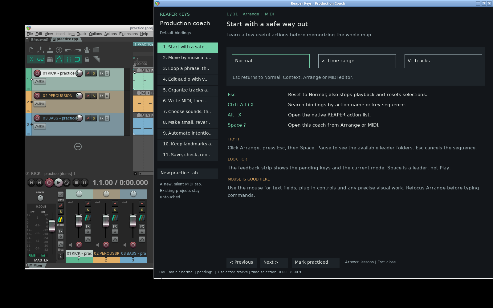
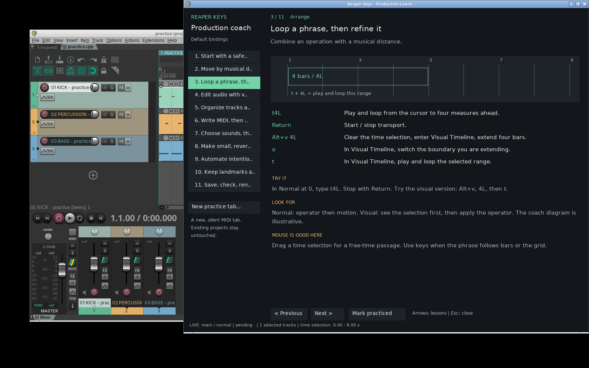
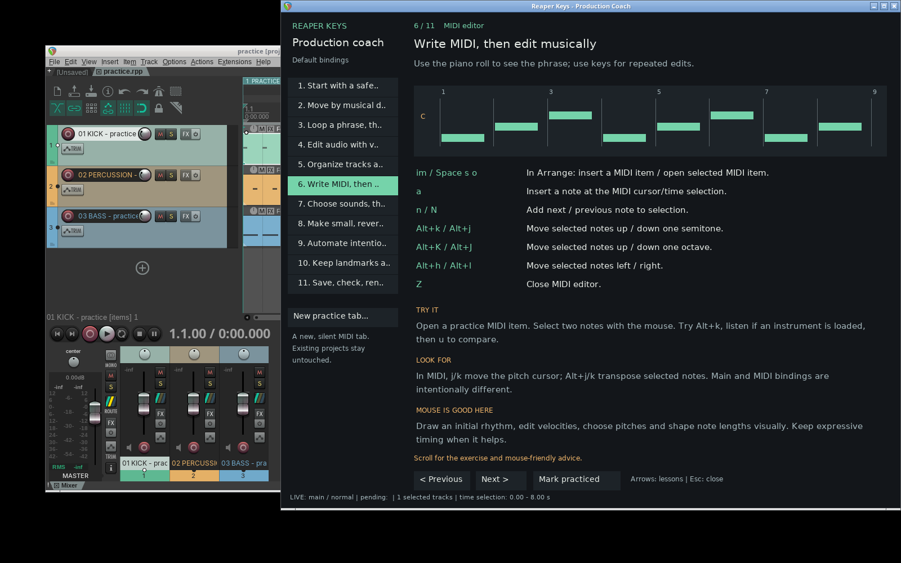

# Produce with reaper-keys: a keyboard-and-mouse guide

Open the in-REAPER coach with **Space, then ?**. Use its **New practice tab…**
button to create a separate, unsaved MIDI practice project. It asks first and
leaves the existing project untouched. No plug-ins or audio files are required;
add instruments if you want to hear the MIDI.

The coach's arrows change lessons when the coach is focused. To try the actual
production shortcuts, click Arrange or the MIDI editor first. Scroll inside the
coach for exercises and mouse-friendly advice. **Mark practiced** records your
own progress; it is not an automatic assessment of your playing or editing.

## Before you begin

- These are the fork's **default** bindings. If you customize them, use
  **Ctrl+Alt+X** to check your actual map.
- Uppercase letters mean Shift. `Space t r` means three sequential keypresses;
  `Ctrl+j` means hold Ctrl and press j. Do not type the spaces between keys.
- `Alt` corresponds to Option where applicable. The live host tests were run on
  Linux; macOS/Windows keyboard layouts still need a human smoke test.
- Keep the feedback strip docked. A floating window can own the keyboard;
  click Arrange/MIDI again if commands stop reaching the project.
- The coach's diagrams explain the operation; they are **not** live displays of
  your notes or waveform. Its bottom status line does read live mode/selection.
- Work in a copy when learning cuts, ripple, automation and recording. Esc is a
  reset, **not Undo**: it also stops playback and resets selections.

## 1. Start with a safe way out

**Context:** Arrange + MIDI. Learn a few useful actions before memorizing the whole map.

- **Esc** — Reset to Normal; also stops playback and resets selections.
- **Ctrl+Alt+X** — Search bindings by action name or key sequence.
- **Alt+X** — Open the native REAPER action list.
- **Space ?** — Open this coach from Arrange or MIDI.

**Try it:** Click Arrange, press Esc, then Space. Pause to see the available leader folders. Esc cancels the sequence.

**Look for:** The feedback strip shows the pending keys and the current mode. Space is a leader, not Play.

**Mouse is good here:** Use the mouse for text fields, plug-in controls and any precise visual work. Refocus Arrange before typing commands.

## 2. Move by musical distances

**Context:** Arrange. Navigate the grid, bars and tracks without dragging the scrollbar.

- **0** — Go to project start.
- **h / l** — Move left / right by one grid division.
- **H / L** — Previous / next measure (bar).
- **4L** — Move forward four measures.
- **j / k** — Select next / previous track.
- **3gg** — Go to track 3; gg goes to track 1.
- **+ / - / zp** — Zoom in / out horizontally; zoom to project.

**Try it:** At project start, try 4L, 4H, then 3gg. Listen in phrases of four or eight bars.

**Look for:** Lowercase l follows the grid; uppercase L follows measures. Counts belong immediately before the motion.

**Mouse is good here:** For a distant, visible target, click it. Use keys for repeatable distances and small adjustments.

## 3. Loop a phrase, then refine it

**Context:** Arrange. Combine an operation with a musical distance.

- **t4L** — Play and loop from the cursor to four measures ahead.
- **Return** — Start / stop transport.
- **Alt+v 4L** — Clear the time selection, enter Visual Timeline, extend four bars.
- **o** — In Visual Timeline, switch the boundary you are extending.
- **t** — In Visual Timeline, play and loop the selected range.

**Try it:** In Normal at 0, type t4L. Stop with Return. Try the visual version: Alt+v, 4L, then t.

**Look for:** Normal: operator then motion. Visual: see the selection first, then apply the operator. The coach diagram is illustrative.

**Mouse is good here:** Drag a time selection for a free-time passage. Use keys when the phrase follows bars or the grid.

## 4. Edit audio with visible selections

**Context:** Arrange. Split, copy and arrange only the material you intend to change.

- **%** — Split selected items at the edit cursor.
- **Y** — Copy selected items.
- **p / 4p** — Paste / repeat paste four times.
- **;** — Move selected items to the edit cursor.
- **sL** — Select items in the next measure AND split at range boundaries.
- **u / Ctrl+r** — Undo / redo.

**Try it:** In the practice project, select an item with the mouse. Move the cursor inside it and press %. Inspect both pieces, then u.

**Look for:** Check selected items, selected tracks, snap and ripple before cuts. sL is not a harmless selection-only command.

**Mouse is good here:** Use the mouse for fades, crossfades, comping and transient-level edits. Zoom in and listen at every join.

## 5. Organize tracks as a group

**Context:** Arrange. Apply track operations to a visible group rather than guessing its extent.

- **o / O** — Insert and name a track below / above.
- **V 2j** — Select this track and the next two in Visual Track.
- **M / S** — In Visual Track, toggle mute / solo for the selection.
- **Space t r** — Rename selected track.
- **Space t x** — Show track routing.
- **Esc** — Return to Normal.

**Try it:** Select the first practice track, type V2j and inspect the three selected tracks. Esc exits without muting them.

**Look for:** V is Visual Track; v is Visual Timeline. The same key can mean something different in another mode.

**Mouse is good here:** Use the routing window to create sends and buses. Do not force complex routing into a blind key sequence.

## 6. Write MIDI, then edit musically

**Context:** MIDI editor. Use the piano roll to see the phrase; use keys for repeated edits.

- **im / Space s o** — In Arrange: insert a MIDI item / open selected MIDI item.
- **a** — Insert a note at the MIDI cursor/time selection.
- **n / N** — Add next / previous note to selection.
- **Alt+k / Alt+j** — Move selected notes up / down one semitone.
- **Alt+K / Alt+J** — Move selected notes up / down one octave.
- **Alt+h / Alt+l** — Move selected notes left / right.
- **Z** — Close MIDI editor.

**Try it:** Open a practice MIDI item. Select two notes with the mouse. Try Alt+k, listen if an instrument is loaded, then u to compare.

**Look for:** In MIDI, j/k move the pitch cursor; Alt+j/k transpose selected notes. Main and MIDI bindings are intentionally different.

**Mouse is good here:** Draw an initial rhythm, edit velocities, choose pitches and shape note lengths visually. Keep expressive timing when it helps.

## 7. Choose sounds, then return to the song

**Context:** Arrange. Keep sound design accessible without losing your place in the arrangement.

- **iv** — Insert a virtual-instrument track; choose the instrument in the dialog.
- **Space f a** — Add an effect to the selected track.
- **Space f c** — Show / hide the track FX chain.
- **Space f b** — Toggle track FX bypass for comparison.
- **Space v m** — Show / hide mixer.

**Try it:** On a disposable track, add an instrument with iv. Use the mouse to choose a preset, then click Arrange to resume key commands.

**Look for:** Level-match before judging bypass. A louder signal can sound deceptively better. The practice project starts without instruments.

**Mouse is good here:** Browse presets, edit synths, adjust EQ curves and route audio with the mouse. These are good visual interfaces.

## 8. Make small, reversible mix moves

**Context:** Arrange. Adjust level in predictable steps while watching meters and listening.

- **Ctrl+j / Ctrl+k** — Track volume down / up by 0.1 dB.
- **Ctrl+J / Ctrl+K** — Track volume down / up by 1 dB.
- **Space t m / Space t s** — Toggle selected-track mute / solo.
- **Space g S** — Unsolo all tracks.
- **Space v p** — Open the REAPER performance meter.

**Try it:** Select one practice track, lower it with Ctrl+J and raise it with Ctrl+K. Watch its fader. Compare in context, not only in solo.

**Look for:** Track volume is not item volume. Counted nudges multiply the step size; start with one, not ten.

**Mouse is good here:** Use the mouse for a broad fader balance and plug-in adjustments. Freeze expensive instruments only after saving a version.

## 9. Automate intentionally

**Context:** Arrange. Shape movement without accidentally overwriting automation.

- **Space e v** — Show / hide the volume envelope.
- **Space a t** — Set selected tracks to Touch automation.
- **Space a r** — Return selected tracks to Trim/Read.
- **q s** — Toggle snap.
- **q c** — Cycle ripple editing; inspect its status.

**Try it:** On a disposable track, show the volume envelope and draw a short fade with the mouse. Keep Trim/Read while learning.

**Look for:** Touch writes while you touch a control. Write mode can overwrite a whole passage: avoid it until you intend that. Ripple can move later material.

**Mouse is good here:** Draw and shape envelopes visually. Keyboard shortcuts are useful for showing lanes and selecting automation modes.

## 10. Keep landmarks and repeat useful work

**Context:** Arrange. Save locations and repeat a tested sequence without retyping it.

- **m a** — Store cursor and selections in mark a.
- **` a** — Recall the cursor position from mark a.
- **, a ... ,** — Record a macro in register a; comma stops recording.
- **3 @ a** — Play macro a three times.
- **.** — Repeat the last repeatable command (not every navigation motion).

**Try it:** In Normal, record ,a l , using no spaces. Play 3@a. Then store ma, move away, and return with `a.

**Look for:** Comma records macros. q opens options. Registers are one key; start with a. Test a macro once before adding a count.

**Mouse is good here:** Use the marker/region manager for naming and organizing song sections. Do not record dialogs or mouse gestures as if they were keys.

## 11. Save, check, render

**Context:** Arrange. Finish with a saved version and an intentional export range.

- **Space p s** — Save project.
- **Space p v** — Save a new project version.
- **Space p r** — Open render settings.
- **Space v R** — Open region/marker manager.

**Try it:** Save a practice copy in your own folder. Open Render, inspect source, bounds, sample rate and filename, then cancel if only practicing.

**Look for:** Check the first and last bar, tail, clipping and file destination. Listen to the rendered file. Do not use last-settings render blindly.

**Mouse is good here:** Use the render dialog and final listening checks. Keyboard speed should never replace output verification.

## A sensible learning order

Spend the first session on navigation and looping. In the next session, add
visible item/track selection and MIDI editing. Learn marks and macros after you
have one repeated workflow worth recording. You do not need to learn every
binding to benefit.

## When something feels wrong

1. Click the intended Arrange/MIDI view; check the context and mode.
2. Press Esc to reset a pending command. It may stop playback/reset selections.
3. Use Ctrl+Alt+X to find the action or Alt+X for REAPER's native action list.
4. Check snap, ripple, selected items/tracks, and automation mode.
5. For slow plug-ins or a busy project, open **Space v p** (performance meter).
   Faster key processing does not lower audio-buffer or plug-in latency.
6. Test macros once before repeating them. They run synchronously; heavy native
   actions can still take time. Recursive macros and excessive counts are rejected.

For installation, rollback and benchmark limits, see [the fork notes](performance.md).

*Generated from `internal/coach/lessons.lua` by `lua5.4 tools/export-guide.lua`.*
